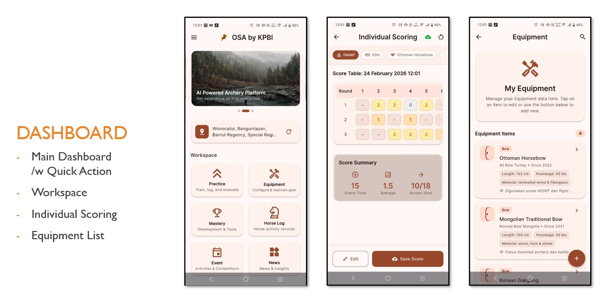

# Super App Boilerplate

Super App adalah aplikasi mobile (Android & iOS) yang dibangun dengan arsitektur Clean Architecture, menggunakan Material 3, dan mendukung multi-bahasa serta multi-template.

**Org (default):** `id.carik.superapp_demo` — ganti dengan milik Anda, lihat [Ubah Application ID](#ubah-application-id).

## Screenshot



*Main dashboard showing banner carousel, quick actions, and workspace icons including Super Module*

---


## 🚀 Persiapan untuk build

Sebelum menjalankan aplikasi, copy file konfigurasi berikut:

```bash
# Windows
copy .env.example .env
copy pubspec.yaml.example pubspec.yaml
copy modules.yaml.example modules.yaml
copy android\key.properties.example android\key.properties

# Linux / macOS
cp .env.example .env
cp pubspec.yaml.example pubspec.yaml
cp modules.yaml.example modules.yaml
cp android/key.properties.example android/key.properties
```

Kemudian edit `.env`, `pubspec.yaml`, dan `modules.yaml` sesuai kebutuhan proyek Anda.
`android/key.properties` hanya wajib untuk release build.

### Ubah Application ID

Boilerplate ini memakai Application ID default `id.carik.superapp_demo`. Sebelum build pertama, ganti dengan package name milik Anda. Satu perintah ini mengubah `namespace` dan `applicationId` di Android, memindahkan `MainActivity.kt` ke package yang baru, memperbarui bundle identifier iOS, serta dokumentasi terkait:

```bash
dart run tool/change_app_id.dart com.company.myapp
```

Detail dan langkah lanjutan (Firebase, Google Sign-In) ada di [`docs/Change-Application-Id.md`](docs/Change-Application-Id.md).

📚 **Dokumentasi lengkap:** [`docs/Development-and-Build.md`](docs/Development-and-Build.md)

---

## 🚀 Cara Menjalankan

```bash
# Clone modul eksternal yang terdaftar di modules.yaml
dart run tool/sync_modules.dart

# Install dependencies
flutter pub get

# Jalankan di debug mode
flutter run

# Build APK
flutter build apk

# Build iOS
flutter build ios

# Build App Bundle rilis (menaikkan build number lebih dulu)
make build
```

---

## 📚 Documentation

| Document | Description |
|----------|-------------|
| [SuperApp-Architecture.md](docs/SuperApp-Architecture.md) | Architecture overview & design |
| [docs/adr/](docs/adr/README.md) | **Architecture Decision Records** — keputusan arsitektur & alasannya |
| [Development-and-Build.md](docs/Development-and-Build.md) | Setup environment & build |
| [API.md](docs/API.md) | Network layer (Dio + Retrofit) |
| [Auth.md](docs/Auth.md) | Authentication system & endpoints |
| [WordPress.md](docs/WordPress.md) | WordPress REST API & JWT Auth support |
| [Modular.md](docs/Modular.md) | Modular architecture guide |
| [SubModule.md](docs/SubModule.md) | External modules integration |
| [Remote-Config.md](docs/Remote-Config.md) | Firebase / Custom Remote Config |
| [Notification.md](docs/Notification.md) | Push notification system (saat ini nonaktif) |
| [Notification-Firebase-Restore.md](docs/Notification-Firebase-Restore.md) | Mengaktifkan kembali FCM |
| [Notification-Onesignal-Restore.md](docs/Notification-Onesignal-Restore.md) | Mengaktifkan kembali OneSignal |
| [GPS.md](docs/GPS.md) | GPS/Location feature |
| [LOCALIZATION.md](docs/LOCALIZATION.md) | Multi-language support |
| [SplashScreen.md](docs/SplashScreen.md) | Splash screen configuration |
| [QuickAction.md](docs/QuickAction.md) | Quick actions system |
| [Permission Helper.md](docs/Permission%20Helper.md) | Permission management |
| [Change-Application-Id.md](docs/Change-Application-Id.md) | Change app ID tool |
| [Release.md](docs/Release.md) | Release keystore & signing guide |
| [Keystore.md](docs/Keystore.md) | Perintah keytool (debug keystore & SHA-1) |

## 📋 TODO (Pengembangan Lanjut)

- [x] Implementasi Google Sign-In (tambah google_sign_in)
- [x] Tambahkan localization strings untuk multi-bahasa (lihat `docs/LOCALIZATION.md`)
- [x] Network Layer dengan Dio + Retrofit (lihat `docs/API.md`)
- [x] Implementasi persistent storage untuk settings (menggunakan SharedPreferences)
- [ ] Tambahkan unit tests dan widget tests
- [x] Implementasi push notifications (lihat `docs/Notification.md`)
- [x] Implementasi remote config (lihat `docs/Remote-Config.md`)
- [ ] Tambahkan analytics

---

## 📋 Changelog

Lihat [CHANGELOG.md](CHANGELOG.md) untuk detail lengkap.

---

## 📅 Tanggal Dibuat
04 Mei 2025

## 👨‍💻 Generated by
[CARIK AI Assistant](https://carik.id)
